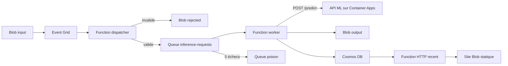

# Pipeline de Machine Learning événementiel sur Azure

**Flavio Tauzin · équipe technique ft · soutenance le 2 décembre 2026.**
Je travaille pour le moment seul, sur mon compte GitHub tauzinflavio et avec mon abonnement Azure for Students. Le sujet prévoit trois ou quatre membres ; l’accord pédagogique pour une présentation individuelle reste à confirmer.

## Premier jalon local

J’ai choisi de prédire, à partir de treize mesures chimiques, lequel de trois cultivars de vigne correspond à l’échantillon. Le modèle renvoie la classe UCI (1, 2 ou 3) et la probabilité estimée. Le jeu Wine comporte 178 échantillons, sans valeur manquante. Le fichier d’origine pèse environ 10,5 Ko. Données de S. Aeberhard et M. Forina, distribuées par scikit-learn à partir du jeu UCI, sous licence CC BY 4.0. [Données et attribution](https://doi.org/10.24432/C5PC7J) · [Licence](https://creativecommons.org/licenses/by/4.0/)

J’ai gardé 45 exemples pour le test et 133 pour l’entraînement, avec la même proportion de chaque classe et la graine 42. J’ai ajusté la standardisation sur les données d’entraînement. Le classifieur naïf prédit toujours la classe majoritaire du train.

| Modèle | Exactitude sur le test | F1 macro |
|---|---:|---:|
| Référence majoritaire | 0,400 | 0,190 |
| Régression logistique standardisée, version 1.0.0 | 1,000 | 1,000 |

Les 45 prédictions correctes concernent ce petit test. La généralisation à d’autres vins demanderait d’autres données. L’artefact pèse 2 247 octets. Sur mon Mac, j’ai mesuré au premier entraînement une médiane de 0,075 ms et le maximum de 0,191 ms pour une prédiction en mémoire (hors réseau). Les mesures du dernier entraînement sont dans `model/evaluation.json`.

## Reproduire le test en Python 3.12

Depuis la racine du projet :

```bash
python3.12 -m venv .venv
source .venv/bin/activate
python -m pip install -r api/requirements.txt -r api/tests/requirements.txt
python model/train.py
python -m pytest -q api/tests
python -m uvicorn api.main:app --host 127.0.0.1 --port 8000
```

Exemple depuis un second terminal :

```bash
curl -s http://127.0.0.1:8000/health
curl -s http://127.0.0.1:8000/version
curl -s http://127.0.0.1:8000/predict -H 'Content-Type: application/json' \
  -d '{"features":[14.23,1.71,2.43,15.6,127,2.8,3.06,0.28,2.29,5.64,1.04,3.92,1065]}'
curl -s http://127.0.0.1:8000/metrics
```

Les mesures suivent l’ordre UCI : alcool, acide malique, cendres, alcalinité des cendres, magnésium, phénols totaux, flavonoïdes, phénols non flavonoïdes, proanthocyanines, intensité de couleur, teinte, rapport OD280/OD315 et proline. Les métriques locales comptent les prédictions réussies du processus.

## Architecture cible



Le stockage inclura aussi le conteneur models. L’identité GitHub de production déploiera via OIDC. La télémétrie doit réunir Functions et API dans Application Insights et un seul workspace Log Analytics plafonné à 0,2 Go par jour.

## Suivi des exigences

| Partie du sujet | Preuve obtenue ou à recueillir |
|---|---|
| 4.1 Modèle | Entraînement reproduit, modèle exporté, comparaison et latence mesurées |
| 4.2 API | Les quatre routes existent ; trois tests locaux réussis. Dockerfile multi-étapes écrit. Taille d’image, GHCR, télémétrie, sondes Azure et retour à zéro à vérifier |
| 4.3 Pipeline | Démontrer validation de l’extension, de la taille et du schéma, rejet motivé, idempotence par nom + ETag, file poison et délai inférieur à une minute |
| 4.4 Données et site | Cosmos Free Tier avec base pipeline à 400 RU/s partagés ; site avec tableau, graphique, 20 derniers résultats, CORS restreint et actualisation à 30 s à démontrer |
| 4.5 Supervision | Deux métriques, alerte réellement déclenchée avec notification, trois requêtes KQL avec captures à produire |
| 4.6 CI/CD | Dépôt, environnement production, relecteur, GHCR version + SHA, déploiement OIDC et preuve du commit à préparer |
| 4.7 FinOps | Région commune à vérifier sur le compte. Budget 25 USD avec alertes à 5, 12,50 et 20 USD. Coût à J15 et preuves de nettoyage à recueillir |
| L5 et L6 | Vidéo de 5 min maximum ; soutenance de 10 min puis 5 min de questions |

Les étapes Azure de référence sont dans `infra/`. Elles reprennent la section 6, en rétablissant les espaces, les guillemets et les retours de ligne du PDF. Le versionnage Blob demandé en section 2 est ajouté explicitement. Avant leur exécution : vérifier la région, établir l’estimation initiale, créer le budget du groupe et ses notifications. Créer Cosmos en premier parmi les services pour tester la capacité. Le code Python est une implémentation des exigences : le PDF fournit les commandes Azure et un extrait de workflow.

## Pénalités et calendrier

- Secret dans le dépôt : −2 points. Utiliser des identités managées ; vérifier aussi l’historique Git et les captures avant publication.
- Dépassement de 25 USD : −2 points. Les alertes avertissent sans arrêter les ressources. Suivre les dépenses et interrompre les essais avant le plafond.
- Ressources encore actives 48 h après la soutenance : −1 point. Nettoyage prévu juste après la démonstration du 2 décembre. Vérifier le groupe avec `az group exists` et rechercher les groupes par défaut associés au projet sans toucher aux ressources d’autres cours.
- Si le 24 novembre compte comme J1, J15 tombe le 8 décembre. Relever alors les coûts historiques filtrés sur le tag projet=dscc même après suppression. Conserver les captures dans docs.

## Comment je traite les fichiers

Je dépose un fichier JSON par vin dans `input/`. J’accepte un champ `features` de treize nombres et une taille maximale de 64 Kio. J’ai fourni un exemple valide et un exemple incomplet dans `docs/exemples/`. Pour une entrée invalide, je conserve le fichier original et un document qui explique le rejet.

Pour distinguer deux versions d’un fichier, j’utilise ensemble son nom et son ETag. Le worker relit la version correspondante du blob. Si le résultat existe déjà, il le réutilise pour terminer l’écriture Cosmos. Ainsi, une interruption entre les deux écritures ne crée pas une deuxième ligne. Après cinq échecs, Azure Functions doit déplacer le message vers `inference-requests-poison`. Pour la démonstration, je pourrai envoyer un message de test incomplet dans la file et observer son déplacement.

Exemple de message après validation (valeurs illustratives) :

```json
{"fileName":"vin-valide.json","etag":"8D000001","size":81,"timestamp":"2026-11-24T10:00:00Z"}
```

Je vérifie le code depuis la racine avec `PYTHONPATH=functions python -m pytest -q api/tests functions/tests` après avoir installé également `functions/requirements.txt`. Dans GitHub Actions, je teste chaque changement avant la construction de l’image. La publication sur GHCR est réservée aux push sur main.

## Mon tableau de bord

Je consulte les 20 dernières inférences sur le site statique. Chaque ligne indique le fichier, l’heure, le cultivar prédit, la confiance et la durée du calcul. Le graphique compte les prédictions de chaque cultivar parmi les lignes affichées. La page interroge `/api/recent` toutes les 30 secondes. Avant la mise en ligne, je configure `web/config.js` avec l’adresse HTTPS de ma Function App et j’autorise uniquement l’origine de mon site dans sa configuration CORS.
